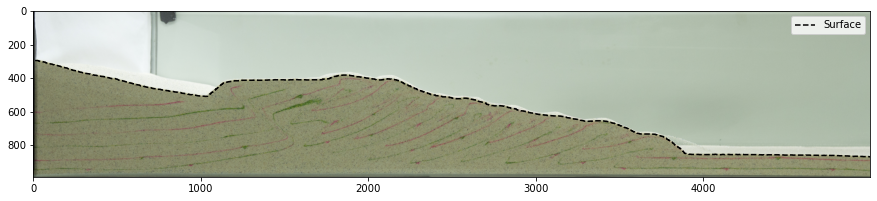

My professional and recreational programming portfolio.

[Here](Phiala_Thouvenin__Resume.pdf) is my resume.

[Here](https://www.linkedin.com/in/phiala-thouvenin/) is my LinkedIn profile.

### Scientific Data Processing Examples
[Here](synthetic_particle_displacement.md) is an example comparing synthetic particle tracking velocimetry (SPTV) to a Runge-Kutta analytic solution of a vector field, showing particles being advected in a shortening zone. A part of the greater package *analogy*, which handles SPTV and other geomechanical/kinematic/thermochronologic modeling of analog tectonic sandbox modeling. [[repo]](https://github.com/phialahydrite/analogy)

[Here](ML_interp.md) is an example of simple machine learning tools as applied to missing particle tracking data. This uses Scikit-learn and Pandas.

[Here](surface_masking_demo.md) is an example of code I wrote to mask images based on foreground and background estimation, using Pandas, HDF5, and image processing tools. [[repo]](https://github.com/phialahydrite/surface_generator)

[Here](slope_calculator.md) is an example of using the surfaces generated in the previous example to give an estimate of surface slope, using Pandas, HDF5, and image processing tools. [[repo]](https://github.com/phialahydrite/slope_calculator)

[Here](gmt_test.md) is an example of manipulating NumPy arrays and saving them as scientific grid file formats (for Generic Mapping Tools and netCDF4). [[repo]](https://github.com/phialahydrite/gridfile)

### Digital Signal Processing Examples

[Here](https://github.com/phialahydrite/morphagene_batchnorm) is a repo used to batch normalize and amplify/attenuate Make Noise Morphagene reels while preserving splice locations already present in the reels.

[Here](https://github.com/phialahydrite/morphagene_onset) is a repo used to automatically detect onset transients in audio .wav files, saving them as splices in correctly-formatted Make Noise Morphagene reels.

___

Please feel free to contact me at [phialathouvenin@gmail.com](mailto:phialathouvenin@gmail.com) with any questions!
