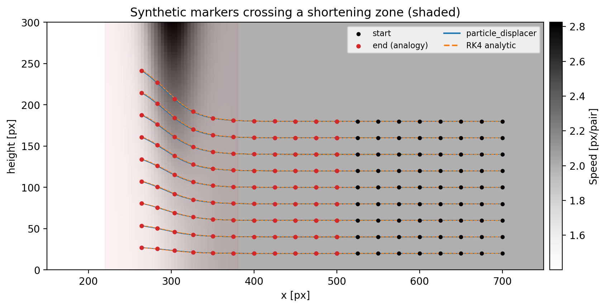
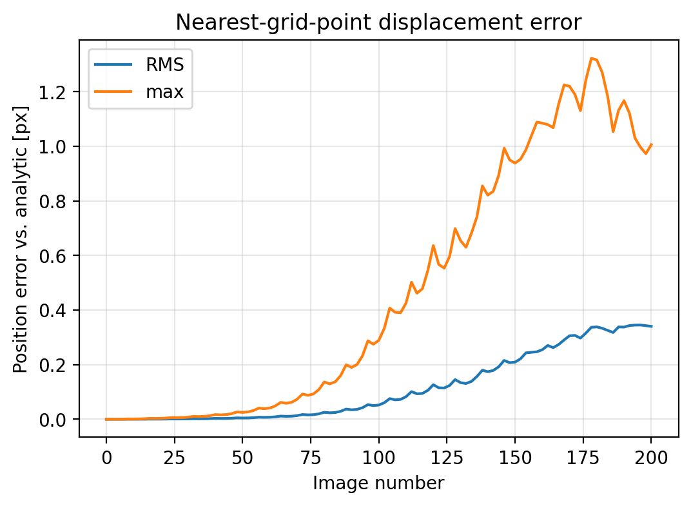

# Synthetic particle displacement with `analogy`

`analogy.particle_displacer` moves synthetic markers through a sequence of
PIVlab velocity files. Real PIV has no ground truth, so it is hard to say how
accurate the resulting tracks are. This example removes that problem by building
the velocity field from a formula: the exact marker paths are known, and the
output of `particle_displacer` can be checked against them.

The full script is `examples/synthetic_particle_displacement.py`. It needs no
data files and no HDF5, and runs in about 6 seconds.

```bash
python examples/synthetic_particle_displacement.py --out ./out
```

**Result:** after 100 PIV pairs the markers are **0.34 px RMS** (max 1.0 px)
from the analytic solution.



## What the model is

A plate moves left at speed `U` and is slowed by a fraction `S` across a narrow
shortening zone centred at `X0` with half-width `WIDTH`. Material to the right
of the zone moves faster than material to the left, so it piles up. For an
incompressible material, that horizontal shortening must be balanced by upward
motion, so the field is:

```
u(x)    = -U * (1 - S * (1 - tanh((x - X0)/WIDTH)) / 2)
v(x, y) =  y * U*S / (2*WIDTH) * sech^2((x - X0)/WIDTH)        (y up)
```

`u` depends only on `x`. `v` is `-y * du/dx`, which is zero at the base of the
model and grows with height, so deeper markers rise less than shallow ones. In
the figure above, the marker starting at 180 px height ends near 240 px, a factor
of about `exp(S)` = 1.35.

Units are pixels, and one "frame" is one PIV image pair.

## Step 1: Parameters and the analytic field

```python
# ---- model & grid parameters (pixels; one "frame" = one PIV image pair) ----
ROI_W, ROI_H = 800, 300         # region of interest
SPACING = 8                     # PIV window spacing
X_MIN = 100                     # ROI offset inside the full image (PIV coords)
U = 2.0                         # plate speed [px per PIV pair]
S = 0.3                         # fraction of speed lost across the zone
X0, WIDTH = 300.0, 40.0         # zone centre and half-width [px]
PIXELMM_SCALE = 3.15            # as in the experiments; used for strain scaling
```

```python
def velocity(x, y):
    t = (x - X0) / WIDTH
    u = -U * (1.0 - S * 0.5 * (1.0 - np.tanh(t)))
    v = y * (U * S / (2.0 * WIDTH)) / np.cosh(t) ** 2
    return u, v
```

`velocity(x, y)` returns `(u, v)` with `y` measured **up** from the base of the
region of interest.

## Step 2: A reference solution

The reference integrates `dx/dt = u`, `dy/dt = v` with 4th-order Runge–Kutta, 20
substeps per PIV pair, on the continuous field. It is not affected by the PIV
grid.

```python
def advect_rk4(x, y, n_pairs, substeps=20):
    """Reference solution: integrate dx/dt = (u, v) per PIV pair."""
    x, y = np.array(x, float), np.array(y, float)
    h = 1.0 / substeps
    path = [np.column_stack((x, y))]
    for _ in range(n_pairs):
        for _ in range(substeps):
            k1 = velocity(x, y)
            k2 = velocity(x + 0.5 * h * k1[0], y + 0.5 * h * k1[1])
            k3 = velocity(x + 0.5 * h * k2[0], y + 0.5 * h * k2[1])
            k4 = velocity(x + h * k3[0], y + h * k3[1])
            x = x + h * (k1[0] + 2 * k2[0] + 2 * k3[0] + k4[0]) / 6
            y = y + h * (k1[1] + 2 * k2[1] + 2 * k3[1] + k4[1]) / 6
        path.append(np.column_stack((x, y)))
    return np.array(path)                        # [n_pairs+1, n_particles, 2]
```

## Step 3: Write the field as PIVlab-style files

`analogy` reads PIVlab text exports: two header lines, a line whose 5th and 8th
words contain the A and B image numbers, and then `x,y,u,v` rows in **image**
coordinates (`y` pointing down, so `v` is negated). Rows are written x-major
(x outer loop, y inner loop), because the strain and vorticity step maps its
output back onto the rows in that order.

```python
def write_piv_files(folder, n_files):
    """
    PIVlab layout expected by analogy: line 2 holds the A/B image names (words
    5 and 8), data starts on line 4 as x,y,u,v in image coordinates (y DOWN, so
    v is negated). Rows are x-major, as the strain/vorticity step assumes.
    """
    os.makedirs(folder, exist_ok=True)
    xs = np.arange(0, ROI_W + 1, SPACING, dtype=float)
    ys_up = np.arange(0, ROI_H + 1, SPACING, dtype=float)
    gx, gy = np.meshgrid(xs, ys_up, indexing="ij")       # x outer, y inner
    u, v_up = velocity(gx, gy)
    files = []
    for k in range(n_files):
        a, b = 2 * k, 2 * k + 2
        path = os.path.join(folder, "PIV_%04i.txt" % k)
        with open(path, "w") as fh:
            fh.write("PIVlab synthetic velocity field\n")
            fh.write("PIVlab pair of images: img_%04i.jpg compared with: img_%04i.jpg\n" % (a, b))
            fh.write("x [px], y [px], u [px/pair], v [px/pair]\n")
            pd.DataFrame({"x": gx.ravel() + X_MIN,
                          "y": (ROI_H - gy).ravel(),      # image y, downward
                          "u": u.ravel(),
                          "v": (-v_up).ravel()}).to_csv(fh, header=False, index=False)
        files.append(path)
    return files
```

## Step 4: Seed markers and run `particle_displacer`

Markers are given in ROI coordinates (`y` up), with a `frame` column for the
frame they start in. The PIV files also give `analogy` a table of frame numbers,
which the function uses to pick the first file that follows a marker's start
frame.

```python
    files = write_piv_files(os.path.join(out, "piv"), args.files)
    framenumbers = pd.DataFrame([an.PIV_framenumbers(f) for f in files],
                                columns=["filenumber", "A_frame", "B_frame"])

    # seed markers in the foreland, in ROI coordinates (y up)
    px, py = np.meshgrid(np.arange(450, 701, 25), np.arange(20, 181, 20))
    particles = pd.DataFrame({"frame": 0, "particle": np.arange(px.size),
                              "x": px.ravel().astype(float),
                              "y": py.ravel().astype(float)})

    tracks = an.particle_displacer(
        files, particles, framenumbers, surface_hdf5=None,
        begin_file=0, end_file=len(files),
        radius=3 * SPACING, mask_piv=False,
        pixelmm_scale=PIXELMM_SCALE, x_min=X_MIN)
```

Three arguments are worth knowing about:

| Argument | Meaning |
|---|---|
| `radius` | A marker only picks up a velocity if a PIV node lies within this many pixels (here 3 windows). Markers that leave the data stop moving. |
| `mask_piv` | If `True`, PIV nodes above the wedge surface are removed using `surface_hdf5`. It is `False` here, so no surface file is needed. |
| `pixelmm_scale`, `x_min` | These were globals in the original scripts. `x_min` shifts PIV coordinates into ROI coordinates, and `pixelmm_scale` scales velocity before it is differentiated for strain and vorticity. |

The returned DataFrame has one row per marker per frame, with columns `frame`,
`particle`, `x`, `y`, `exy` (shear strain) and `vort` (vorticity).

## Step 5: Compare with the analytic solution

```python
    # reference: continuous-field RK4, sampled at the same frames
    ref = advect_rk4(px.ravel(), py.ravel(), len(files))
    frames = np.sort(tracks.frame.unique())               # 0, 2, 4, ... image no.
    err = []
    for i, fr in enumerate(frames):
        g = tracks[tracks.frame == fr].sort_values("particle")
        d = np.hypot(g.x.values - ref[i][:, 0], g.y.values - ref[i][:, 1])
        err.append((fr, np.sqrt(np.mean(d ** 2)), d.max()))
    err = np.array(err)
    print("markers: %i, PIV files: %i, output rows: %i"
          % (px.size, len(files), len(tracks)))
    print("final-frame error vs. analytic [px]: RMS %.2f, max %.2f"
          % (err[-1, 1], err[-1, 2]))
```

Expected output:

```
markers: 99, PIV files: 100, output rows: 9999
final-frame error vs. analytic [px]: RMS 0.34, max 1.01
```



The error starts at zero and grows smoothly as markers pass through the zone.
Each marker takes its velocity from the nearest PIV node and applies it for the
whole pair, so errors build up where the field changes fastest. The maximum error
is at most a pixel here, for a field sampled every 8 px.

## Things to try

* **Coarser grid.** Raise `SPACING`. Final RMS error: 0.34 px at 8, 0.43 px at
  16, 0.94 px at 32.
* **Sharper zone.** Lower `WIDTH` from 40 to 10. The field then changes within
  one PIV window, and RMS error rises to 1.3 px (max 5.2 px).
* **Radius too small.** Call `particle_displacer` with `radius=4`. Markers whose
  nearest node is farther than that never pick up a velocity and stay put. The
  mean final `x` is 510 px, against 378 px with `radius=24`.
* **More shortening.** Raise `S` to 0.5. RMS error rises to 0.63 px, and markers
  rise by a factor of about 1.65, so make sure `ROI_H` is tall enough to
  contain them.
* **Your own fields.** Replace `velocity()` with any function of `(x, y)` that
  returns `(u, v)`. Keep it incompressible if you want physically sensible strain.

## Caveats

* PIV rows must be x-major for `exy` and `vort` to land on the right nodes. This
  example follows that, but exports from your own PIVlab runs may not. Check the
  row order before trusting strain values from real data.
* The `mask_piv=True` path (removing PIV above the wedge surface) is not
  exercised here, because it needs HDF5 surface files.
* `particle_displacer_temperatures` and `particle_displacer_temperatures_dfmfront`
  have not been given the same cleanup as `particle_displacer`. They still read
  variables that were globals in the original scripts.
